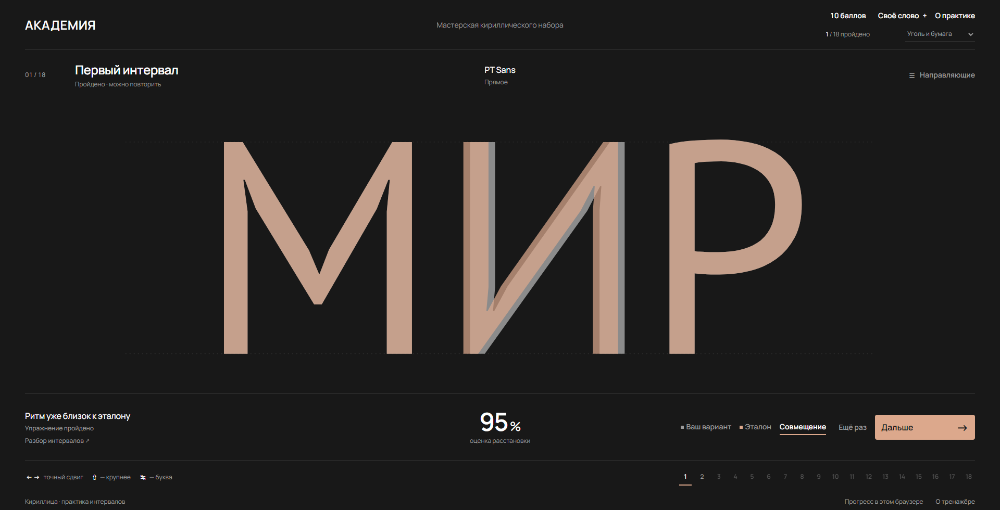

# АКАДЕМИЯ

Мастерская кириллического набора — тренажёр кернинга для студентов академии Штиглица.

**[Открыть тренажёр](https://p34820669-art.github.io/akademiya/)** — доступен без регистрации.



## Возможности

- 18 упражнений: от одной подвижной буквы до пяти.
- Только прописные русские буквы, свои слова от 3 до 18 букв.
- PT Sans, PT Serif, Golos Text и Literata; восемь прямых и курсивных начертаний.
- Плавная оценка 0–100%. При 95–100% доступны «Ещё раз» и «Дальше», ниже 95% — повтор.
- Мышь, сенсорный ввод, стрелки, сравнение с образцом и направляющие.
- Семь цветовых схем, баллы, награды и сохранение прогресса без регистрации.

## Локальный запуск

Нужен Node.js 20 или новее. Зависимости устанавливаются по lock-файлу:

```sh
npm ci
npm start
```

Откройте [http://127.0.0.1:4317](http://127.0.0.1:4317). Статическая версия работает без PHP и базы данных. Файлы тренажёра уже подготовлены в `dist/`; генерировать шрифты для запуска не требуется.

## Проверки и сборка

```sh
npm test
npm run package:spaceweb
```

Первая команда проверяет оценку, движение, прогрессию, награды, сохранения и контраст. Вторая собирает комплект для размещения в `artifacts/spaceweb/`.

GitHub Actions запускает тесты и проверяет сборку после push и pull request. После успешной проверки ветки main публикует содержимое dist/ на GitHub Pages. Серверные настройки и PHP-файлы в публикацию не входят.

## Размещение и статистика

Статическая версия опубликована на [GitHub Pages](https://p34820669-art.github.io/akademiya/). Сохранение прогресса, упражнения и награды работают без сервера и регистрации. GitHub Pages не выполняет PHP, поэтому сбор посещаемости и почтовые отчёты в этой версии отключены.

Содержимое `dist/` также можно разместить на другом статическом хостинге. Для обезличенной статистики и почтовых отчётов подготовлен PHP-сервер: [инструкция для Spaceweb](SELF_HOSTING.md). PHP 8.3+ и MySQL нужны только для отчётов.

Настройки базы и почты хранятся в закрытом `config.php` вне публичной папки. В репозитории находится только [образец настроек](server/config.example.php). Получатель отчётов задаётся при установке.

Прогресс хранится в localStorage, cookie содержит случайный идентификатор браузера. Очистка данных сайта удаляет прогресс; синхронизации между устройствами нет.

## Структура

| Папка | Содержимое |
|---|---|
| `dist/` | Готовый тренажёр, шрифты и лицензии |
| `scripts/` | Локальный сервер, генерация учебных материалов, сборка комплектов |
| `server/` | Статистика и почтовые отчёты |
| `web-api/` | Публичная точка входа PHP API |
| `tests/` | Проверки JavaScript и PHP |
| `docs/` | Снимок интерфейса и описание механики |

## Документация и источники

- [Механика, оценка и подготовка шрифтов](docs/MECHANICS.md).
- [Оформление](DESIGN.md).
- [Проведённые проверки](QA.md).
- [Шрифты и сторонние материалы](THIRD_PARTY_NOTICES.md).

Механика вдохновлена [Kern Type](https://type.method.ac/) от [Method of Action](https://method.ac/). Учебные образцы рассчитаны по данным гарнитур и авторским поправкам. Они не утверждены академией; перед использованием на занятиях преподаватель может уточнить эталоны.
